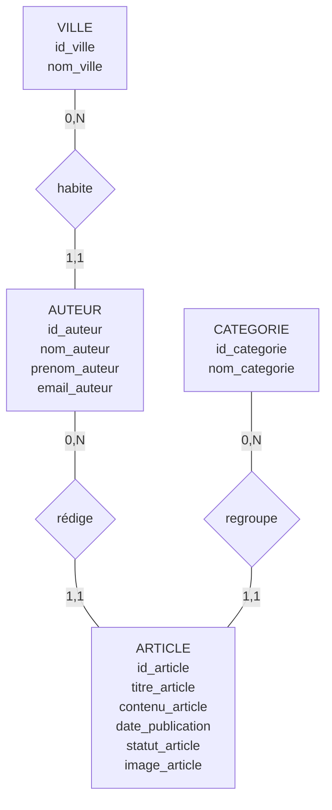

# MCD complet du Blog

## 1. Les entités

### VILLE
- <u>id_ville</u>
- nom_ville

### AUTEUR
- <u>id_auteur</u>
- nom_auteur
- prenom_auteur
- email_auteur

### ARTICLE
- <u>id_article</u>
- titre_article
- contenu_article
- date_publication
- statut_article
- image_article

### CATEGORIE
- <u>id_categorie</u>
- nom_categorie

## 2. Les relations et cardinalités

- VILLE (0,N) — habite — (1,1) AUTEUR
- AUTEUR (0,N) — rédige — (1,1) ARTICLE
- CATEGORIE (0,N) — regroupe — (1,1) ARTICLE

## 3. Schéma du MCD

**Remarque :** La donnée calculée `duree_lecture` est exclue du MCD.